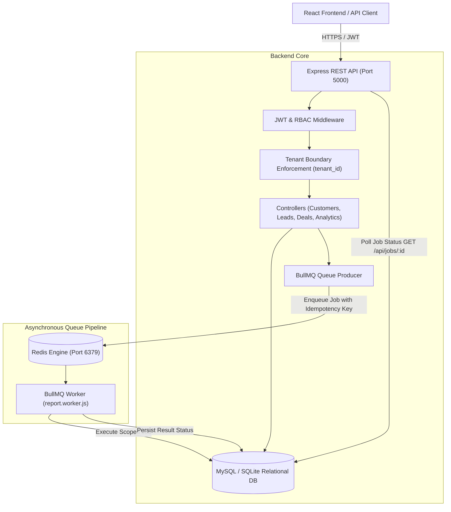
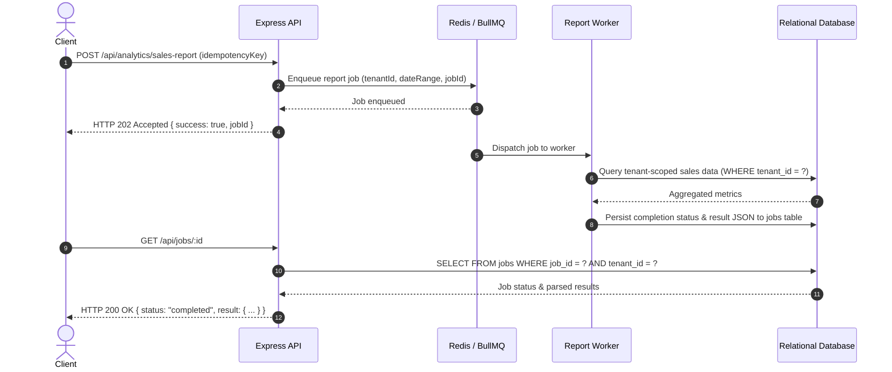

# Core CRM - Production-Grade Kenyan SME & SACCO Platform

Core CRM is a multi-tenant, enterprise-ready Customer Relationship Management (CRM) system engineered for Kenyan Small and Medium Enterprises (SMEs) and SACCO-style organizations. It provides localized business workflows, county-based market segmentation (47 Kenyan counties), Kenyan Shilling (KES) currency, M-Pesa transaction auditing, asynchronous report generation with BullMQ, strict tenant isolation, and role-based access control (RBAC).

---

## 🏗️ Architecture Overview

The system is decoupled into an Express REST API backend, a background worker process powered by BullMQ & Redis, a relational database layer (MySQL with an automated SQLite development fallback), and a modern React/Vite frontend.



---

## 🔒 Multi-Tenant Isolation & RBAC Architecture

Tenant isolation is enforced as a first-class security boundary:

1. **Database Schema Enclosure**: Every table (`users`, `customers`, `leads`, `deals`, `tasks`, `communications`, `mpesa_transactions`, `activity_log`, and `jobs`) maintains a foreign key constraint referencing `tenants(id)`.
2. **Middleware Contextualization**: Upon verifying the signed JWT token, `protect` middleware attaches `req.user` containing `tenant_id` and role permissions.
3. **Query Parameterization**: Controllers inject `WHERE tenant_id = req.user.tenant_id` into all queries. Cross-tenant reads and mutations return `404 Not Found` or `403 Forbidden`.
4. **Role-Based Access Control (RBAC)**:
   - `admin`: Full administrative access to tenant users, reports, deal stages, and record deletions.
   - `manager`: Management access to team deals, leads, customer assignments, and analytics.
   - `sales_rep`: Access restricted to assigned leads and customer accounts; destructive deletions forbidden.

---

## ⚡ Asynchronous Processing Architecture (BullMQ)

Long-running workflows (such as heavy sales analytics and financial aggregations) do not execute synchronously on HTTP request threads. They adhere strictly to the target architecture:

`API → Queue → Redis → Worker → Job Processing → Result Persistence → Status API`



### BullMQ Features
- **Idempotency**: Requests accepting an `idempotencyKey` reuse existing job identifiers to prevent duplicate processing.
- **Result Persistence**: Job execution outputs (including record counts, revenue sums, pipeline aggregations, and failure tracebacks) are committed to the `jobs` database table.
- **Tenant Isolation on Jobs**: Job status retrieval (`GET /api/jobs/:id`) strictly validates that `tenant_id` matches the authenticated requester.

---

## 🧪 Comprehensive Test Suite

The test suite covers unit, integration, RBAC, and multi-tenant security verification using **Jest** and **Supertest**.

```bash
cd backend
npm test
```

### Test Suite Execution Summary (37 Tests Total)

| Test Suite | Spec File | Tests Passed | Key Capabilities Verified |
| :--- | :--- | :--- | :--- |
| **Authentication & Profile** | `tests/auth.test.js` | 7 / 7 | User registration, password hashing (bcrypt), login token generation, token verification, malformed token rejection, profile update. |
| **Customer Management** | `tests/customers.test.js` | 9 / 9 | Customer creation, list filtering, detail retrieval, validation of Kenyan mobile formats, **tenant boundary isolation**, and RBAC delete guard. |
| **Lead Lifecycle & Conversion** | `tests/leads.test.js` | 8 / 8 | Lead creation, phone validation (`+254`), search/filter, **tenant boundary isolation**, conversion of qualified lead into customer record. |
| **Deals & Pipeline** | `tests/deals.test.js` | 8 / 8 | Deal creation with stage validation, cross-tenant customer reference rejection, tenant isolation on updates/reads, RBAC delete permission. |
| **BullMQ Jobs & Workers** | `tests/jobs.test.js` | 5 / 5 | HTTP 202 async dispatch, idempotency key deduplication, worker execution, result persistence in `jobs` table, cross-tenant job access rejection. |
| **Total Test Runs** | **5 Suites** | **37 / 37** | **100% Passing** |

---

## 📦 Setup & Installation

### Prerequisites
- Node.js >= 18.x
- Redis >= 6.x (or Docker container)
- MySQL 8.x (or built-in SQLite development engine)

### 1. Environment Variables Configuration

Copy `.env.example` in `backend/` and configure:

```ini
PORT=5000
NODE_ENV=development
FRONTEND_URL=http://localhost:5173

# Database (Leave empty to use automatic SQLite fallback in development/test)
DB_HOST=localhost
DB_USER=root
DB_PASSWORD=your_password
DB_NAME=kenya_crm
DB_PORT=3306

# Authentication
JWT_SECRET=super_secure_jwt_secret_key_crm_2026
JWT_EXPIRE=7d

# Redis & Queues
REDIS_HOST=localhost
REDIS_PORT=6379

# Rate Limiting
RATE_LIMIT_WINDOW_MS=900000
RATE_LIMIT_MAX_REQUESTS=100
```

### 2. Backend Initialization & Tests

```bash
cd backend
npm install
npm test
npm run dev
```

### 3. Queue Worker Process

In a separate terminal or service runner:
```bash
cd backend
npm run worker
```

### 4. Frontend Application

```bash
cd frontend
npm install
npm run build
npm run dev
```

---

## 🛡️ Security Audit & Threat Hardening

1. **Injection Prevention**: All SQL queries across MySQL and SQLite utilize parameterized bindings (`?`). Dynamic SQL strings are eliminated.
2. **Strict Tenant Boundaries**: Controllers disallow global `id` lookups. Every query incorporates `req.user.tenant_id`.
3. **Password Security**: Passwords are encrypted using bcrypt with cryptographic salt rounds.
4. **Header Hardening**: `helmet` is enabled on all routes, preventing clickjacking, MIME sniffing, and cross-site scripting (XSS).
5. **Rate Limiting**: Express rate limiting guards against brute-force credential stuffing and denial of service.
6. **Hostile Input Validation**: Express validator enforces Kenyan telephone numbers (`+254...` or `07...`), valid emails, and required status fields.

---

## 🚀 CI/CD Pipeline

The repository includes a GitHub Actions continuous integration pipeline (`.github/workflows/ci.yml`):
- **Backend Test Matrix**: Runs tests across Node.js 18.x and 20.x with a live Redis service container.
- **Frontend Build**: Verifies that React/Vite assets compile cleanly without bundling warnings.
- **Docker Compose Validation**: Ensures infrastructure definitions pass syntax and linting checks.

---

## ⚠️ Known Limitations & Roadmap

1. **M-Pesa Daraja Callback Webhook**: `c2b-simulate` provides sandbox logging; production deployment requires public SSL webhook routing (e.g., Safaricom Daraja C2B/B2C callbacks).
2. **WebSocket Real-Time Notifications**: Currently, background job status uses polling on `/api/jobs/:id`; a planned enhancement involves socket notifications when jobs complete.
