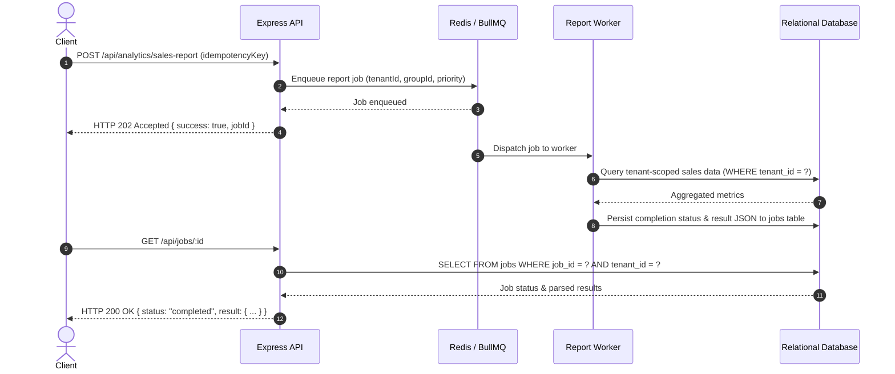

# Core CRM - Production-Grade Kenyan SME, Real Estate & Legal Multi-Tenant SaaS

Core CRM is an enterprise-ready, multi-tenant Software-as-a-Service (SaaS) Customer Relationship Management and Operations platform engineered specifically for the Kenyan market. Built on an event-driven architecture, it combines a robust shared multi-tenant core with three deep, specialized industry verticals:

1. **🏢 Land & Real Estate Operations**: Interactive Plot Matrix (Green/Yellow/Red availability with 48h timed reservation hold state machine), "Lipa Mdogo Mdogo" 4-stage statutory installment tracking with automated M-Pesa matching, Saturday Kencom site visit convoy booking with passenger manifests, and an ArdhiSasa 5-stage regulatory conveyancing pipeline.
2. **💼 Commercial Core Edition**: Products & services catalog with SKUs and KES pricing, Quotation and Tax Invoice generation with automated 16% VAT and KRA eTIMS Fiscal CU numbers, 1-click quote-to-invoice conversion, branded PDF generation, 30/60/90-day debtor aging analysis, and 1-click M-Pesa STK push.
3. **⚖️ Legal Practice & Advocacy Edition**: Kenyan Constitutional court hierarchy (Arts. 159–173 CoK 2010), Judiciary e-Filing nomenclature, litigation retainer milestones, Order 11 CPR pre-trial conference fixtures, billable hours tracking, and Advocates Remuneration Order (ARO) fee computation.

The platform includes **Executive P&L Analytics** with staff productivity ROI appraisal (Bonuses vs Layoffs recommendation), OPEX ledger, automated organization onboarding, 47 Kenyan county market segmentation, Safaricom Daraja M-Pesa automation with AES-256 encrypted credential vaults, BullMQ asynchronous report workers with Redis, strict tenant isolation, refresh token rotation with immediate blocklist revocation, and Kenya Data Protection Act 2019 (KDPA) compliance.

---

## 🏗️ Architecture Overview

The system is architected as an event-driven, decoupled SaaS platform composed of an Express REST API backend, BullMQ & Redis background worker processes, a relational database layer (MySQL 8.0+ with an automated, zero-config SQLite development fallback), and a modern React 18/Vite frontend styled with Tailwind CSS.

```mermaid
graph TD
    Client["React Frontend / Vite Client"] -->|HTTPS (Subdomain / Bearer JWT)| APIGateway["Express REST API (Port 5000)"]
    
    subgraph "Backend Core & Security Middleware"
        APIGateway --> ResolveTenant["Subdomain & Header Tenant Resolver"]
        ResolveTenant --> Auth["JWT & Token Revocation Blocklist Guard"]
        Auth --> RBAC["Role-Based Access Control (Admin, Manager, Sales Rep)"]
        RBAC --> TenantGuard["Query Safety Guardrail (tenant_id)"]
        TenantGuard --> Controllers["Controllers (Parcels, Invoices, Conveyancing, Deals, M-Pesa, Analytics)"]
        Controllers --> DB[("MySQL / SQLite Relational Database")]
        Controllers --> QueueProducer["BullMQ Queue Producer (Tenant-Grouped)"]
    end

    subgraph "Asynchronous Queue Pipeline & Workers"
        QueueProducer -->|Tenant Fair Scheduling & Idempotency| Redis[("Redis Engine (Port 6379)")]
        Redis --> Worker["BullMQ Report & Event Worker"]
        Worker -->|Execute Tenant-Scoped Aggregations| DB
        Worker -->|Persist Status & JSON Result to jobs Table| DB
        APIGateway -->|Poll Job Status GET /api/jobs/:id| DB
    end

    subgraph "External Integrations"
        Safaricom["Safaricom Daraja API"] -->|Public C2B Webhook & STK Push Callback| Controllers
        KRA["KRA eTIMS Standard"] -->|Fiscal CU Signature & Verification| Controllers
    end
```

---

## 🌟 Industry Verticals & Capabilities

### 1. 🏢 Real Estate & Land Brokerage Operations (`/parcels` & `/deals`)
- **Interactive Plot Matrix (Visual Estate Grid)**:
  - Color-coded grid displaying **Green** (Available), **Yellow** (Reserved on Timed Hold), and **Red** (Sold & Titled).
  - Deterministic state machine: When a Letter of Offer (LOO) is generated, a 24-hr, 48-hr, or 72-hr countdown timer activates. If the deposit is not satisfied within the window, the plot automatically releases back to Green without manual staff intervention.
  - Complete state transition audit trail logged in `parcel_status_history`.
- **"Lipa Mdogo Mdogo" Installment Tracker**:
  - Automatically calculates 4 statutory land acquisition milestones:
    1. `10% Commitment Deposit & Offer Letter` (7-day window)
    2. `30% Beaconing & Survey Mutation Sign-off` (30-day window)
    3. `30% Land Control Board (LCB) Statutory Consent` (60-day window)
    4. `30% Final Settlement & Title Deed Transfer` (90-day window)
  - **M-Pesa Auto-Reconciliation**: Enter any Safaricom Daraja transaction receipt number (e.g. `QK87XP492L`) to auto-credit the milestone and flip status to Paid.
- **Saturday Site Visit Convoy Booking**:
  - Scheduled convoys departing Nairobi hubs (Kencom House CBD, Kenrail Westlands) to project estates (e.g. Juja Ridge Phase 2, Kangundo Plains, Acacia Heights).
  - Fleet management: 33-Seater Executive Shuttles, 14-Seater Tour Vans, and 4x4 VIP Cruisers with real-time seat quota progress bars.
  - Interactive Passenger Manifest table tracking investor phone numbers, pickup stops, and reservation status.
- **ArdhiSasa 5-Stage Conveyancing Pipeline (`/deals?tab=conveyancing`)**:
  - Eliminates the legal "black box" between real estate agents, purchasers, and advocates through a live 5-column Kanban board:
    1. *Search & Registry*: ArdhiSasa NLIMS digital search & Green Card encumbrance verification.
    2. *Beacon & Mutation*: Licensed surveyor beacon re-pegging & survey mutation filing.
    3. *Land Control Board (LCB)*: Sub-county board (Cap 302) hearing schedule & consent issuance.
    4. *Valuation & Stamp Duty*: Ministry of Lands valuation, KRA 4% stamp duty payment, and CGT clearance.
    5. *Title Deed Handover*: Lands Registry transfer endorsement & registered Title Deed issuance.

### 2. 💼 Commercial Core Edition (`/invoices`)
- **Products & Services Catalog**: SKU codes, units of measure, and KES list prices (e.g., 5,000L Roto Tanks, 5kVA Solar Inverters, Grade 500 TMT Rebars, Simba Cement).
- **Quotation & Tax Invoice Engine**: Line-item itemization, automated **16% VAT**, and KRA eTIMS Fiscal CU numbers (`KRA-ETIMS-XXXX`).
- **1-Click Convert Quote to Invoice**: Instantly converts any quotation (`QT-2026-XXXX`) into an official tax invoice (`INV-2026-XXXX`) while preserving foreign keys and customer history.
- **Branded Tax Invoice Modal**: Printable and downloadable KRA-compliant tax invoices ready for client delivery.
- **30/60/90-Day Debtor Aging Analysis**:
  - 4 aging buckets: Current (0–30 days), 31–60 days, 61–90 days, and 90+ days critical.
  - Ranked overdue debtor list with 1-click WhatsApp payment demand dispatch (`wa.me`).
- **⚡ 1-Click M-Pesa STK Push**: Triggers instant Daraja push (`Paybill 174379`) to debtor mobile devices. The callback handler shifts debtor aging buckets from overdue to paid immediately without manual accountant intervention.

### 3. ⚖️ Legal Practice Edition (`/matters` & `/deals`)
- **Strict Constitutional Court Hierarchy (Arts. 159–173 CoK 2010)**:
  - Superior Courts of Record (Supreme Court, Court of Appeal, High Court divisions, Environment & Land Court, Employment & Labour Relations Court).
  - Subordinate Courts (Magistrates' Courts, Kadhis' Courts, Small Claims Court).
  - Specialized Tribunals (Tax Appeals Tribunal, Rent Restriction Tribunal, Business Premises Rent Tribunal, Cooperative Tribunal, National Environment Tribunal).
- **Judiciary e-Filing Standardization**: Case reference formatting (`HCCC NO. E... OF 2026`, `ELC NO. ... OF 2026`), pleading standing (`Plaintiff vs Defendant`, `Petitioner vs Respondent`), and coram honorifics (`Hon. Lady Justice ...`, `Hon. Mr. Justice ...`).
- **Advocates Remuneration Order (ARO)**: Instruction fees, 16% VAT, and disbursements schedule calculator with Order 11 pre-trial conference milestones.

### 4. 📊 Executive Analytics & Staff Productivity Matrix (`/analytics`)
- **Full P&L Financial Scorecard**: Gross revenue inflows, Operating Expenditure (OPEX), Net Profit, and Net Operating Margin %.
- **Staff Productivity & Appraisal Matrix (Bonuses vs Layoffs)**:
  - Evaluates each team member on Net Contribution and Productivity ROI Multiplier ($\text{Revenue Generated} / \text{Cost Incurred}$).
  - Real-time HR decision recommendations:
    - 🌟 **Star Performer (Bonus Recommended)**: $\text{ROI} \ge 3.0\times$ or Revenue > KES 2.0M.
    - 🟢 **Solid Contributor (Retain & Expand)**: $\text{ROI} = 1.5\times - 3.0\times$.
    - 🟡 **Needs Coaching (Performance Watch)**: $\text{ROI} = 0.8\times - 1.5\times$.
    - 🔴 **Underperforming (At-Risk / Layoff Review)**: $\text{ROI} < 0.8\times$ or loss-making burn.
    - 👔 **Executive Leadership**: Administrative non-sales management.
- **Operating Expenditure (OPEX) Ledger**: Salaries & payroll, sales commissions, transport & fuel, legal/ArdhiSasa filing fees, marketing, utilities, with receipt attachments and staff/deal attribution.
- **Boardroom Brief Export**: One-click printable briefing document designed for quarterly director meetings, HR appraisals, and investor presentations.

---

## 🔒 Multi-Tenant Security & Infrastructure Guardrails

1. **Deterministic Tenant Isolation (`tenant_id`)**: Every database query is scoped by `tenant_id`. An automated safety wrapper (`db.forTenant(tenantId)`) enforces tenant constraints across all 20+ tables. Cross-tenant reads, modifications, or deletes fail closed with `404 Not Found`.
2. **Encrypted M-Pesa Vault**: Safaricom Consumer Keys, Secrets, and Passkeys are encrypted at rest using **AES-256-GCM** with unique initialization vectors (IVs). Keys are masked (`abcd****7890`) upon administrative retrieval.
3. **Session Invalidation & Token Revocation**: Issues short-lived JWT access tokens alongside rotating refresh tokens (`POST /api/auth/refresh`). On logout, tokens are immediately committed to `token_blocklist`, preventing reuse even before expiration.
4. **Kenya Data Protection Act (KDPA 2019)**:
   - Automated telephone number masking in Winston application logs (`+254 7XX *** *89`).
   - Section 26 Right to Access: `GET /api/customers/:id/kdpa-export` generates machine-readable data exports.
   - Right to Erasure / Anonymization: `POST /api/customers/:id/anonymize` sanitizes PII into synthetic hashes while preserving relational integrity for tax and financial auditing.
5. **Fair BullMQ Worker Scheduling**: Tenant-grouped background queues (`groupId: tenant:<tenantId>`) prevent high-volume tenants from starving shared worker capacity.
6. **Zero-Config Database Engine**: Uses an automated SQLite development fallback with foreign key enforcement and migration replay when MySQL is not present, enabling zero-configuration development and automated testing out of the box.

---

## ⚡ BullMQ Asynchronous Workflow

Long-running operations adhere strictly to the target architecture:

`API → Queue → Redis → Worker → Job Processing → Result Persistence → Status API`



---

## 🧪 Comprehensive Test Suite (17 Suites, 97 / 97 Tests Passing - 100%)

The automated test suite verifies unit logic, integration endpoints, RBAC permissions, strict tenant isolation, M-Pesa credential encryption, and background queue handling using **Jest** and **Supertest**.

```bash
cd backend
npm test
```

### Verified Test Suite Invariants

| Test Suite | Spec File | Tests Passed | Key Invariants Verified |
| :--- | :--- | :---: | :--- |
| **Sprint Upgrades (Commercial & Land)** | `tests/sprint_upgrades.test.js` | 5 / 5 | Products catalog SKUs/KES, quote generation, quote-to-tax-invoice conversion with eTIMS, Lipa Mdogo Mdogo 4-stage milestones with M-Pesa matching, Saturday site visit convoy seat bookings. |
| **Executive Analytics & OPEX** | `tests/analytics.test.js` | 6 / 6 | P&L summary, staff productivity ROI matrix (bonus vs layoff recommendations), OPEX expenditure creation, RBAC delete guards, **cross-tenant financial isolation**. |
| **Advanced Industry Capabilities** | `tests/advanced_features.test.js` | 3 / 3 | Plot Matrix state machine & 48h timed reservation holds, KRA eTIMS invoice generation with 16% VAT, ArdhiSasa 5-stage conveyancing milestones. |
| **Authentication & Profile** | `tests/auth.test.js` | 7 / 7 | Password hashing (bcrypt), login token generation, malformed token rejection, profile update. |
| **Customer Management** | `tests/customers.test.js` | 9 / 9 | Customer CRUD, Kenyan mobile validation (`+254`), **strict cross-tenant boundary isolation (404 on cross-read/write)**, RBAC delete guard. |
| **Lead Lifecycle & Conversion** | `tests/leads.test.js` | 8 / 8 | Lead creation, phone validation, search/filter, **cross-tenant isolation**, 1-click conversion into customer record. |
| **Deals & Pipeline** | `tests/deals.test.js` | 10 / 10 | Deal stages, cross-tenant customer reference rejection, tenant isolation on updates/reads, RBAC delete guard. |
| **BullMQ Jobs & Workers** | `tests/jobs.test.js` | 5 / 5 | HTTP 202 async dispatch, idempotency key deduplication, worker execution, result persistence in `jobs` table, cross-tenant job access rejection. |
| **Report Producer** | `tests/reportProducer.test.js` | 4 / 4 | Tenant and user validation, retry bounds, tenant-prefixed idempotency keys. |
| **Report Endpoints** | `tests/reports.test.js` | 2 / 2 | Unauthenticated and malformed token rejection on async reporting routes. |
| **SaaS Multi-Tenant Lifecycle** | `tests/saas_multitenant.test.js` | 10 / 10 | Self-service tenant registration, deal stage auto-seeding, slug collision, public tenant lookup, refresh token rotation, token revocation blocklist on logout, M-Pesa AES-256 credential encryption, public Daraja webhook routing by shortcode, KDPA data export and PII anonymization. |
| **Land Parcels & Inventory** | `tests/parcels.test.js` | 5 / 5 | Land parcel creation, status filtering, **cross-tenant isolation**, status history, unique title_ref scoped to tenant. |
| **Legal Matters & Billable Hours** | `tests/matters.test.js` | 3 / 3 | Legal matter creation, court station assignments, **cross-tenant isolation**, billable time logging. |
| **Tasks, Communications & Admin** | `tests/tasks_communications_users.test.js` | 3 / 3 | Task CRUD, WhatsApp/interaction logs, user invitations and RBAC enforcement. |
| **Authorization Middleware** | `tests/authorize.test.js` | 4 / 4 | Missing token rejection, unauthorized role rejection (403), allowed role pass-through. |
| **Migration Statement Splitter** | `tests/migrate.split.test.js` | 2 / 2 | SQL statement parsing preserving semicolons in string literals, comment stripping. |
| **System Health API** | `tests/health.test.js` | 1 / 1 | System heartbeat and operational telemetry. |
| **Total Test Runs** | **17 Suites** | **97 / 97** | **100% Passing** |

---

## 📦 Quickstart & Live Verification

### 1. Prerequisites
- **Node.js**: >= 18.x
- **Database**: Automatic SQLite development fallback included (or MySQL 8.0+)
- **Redis**: Optional (transparent fallback for local development)

### 2. Installation & Running

```bash
# Clone the repository
git clone https://github.com/your-org/core-crm.git
cd core-crm

# Backend Setup & Migrations
cd backend
npm install
npm run migrate
npm test               # Run all 17 test suites (97 tests)
npm run dev            # Starts backend on http://localhost:5000

# Frontend Setup (in a second terminal)
cd ../frontend
npm install
npm run build          # Verifies 0 compile errors
npm run dev            # Starts frontend on http://localhost:5173
```

---

## 👥 Demo Profiles for Live Testing

Navigate to `http://localhost:5173` and log in with any of the following pre-seeded industry profiles:

| Industry Vertical | Login Email | Password | Primary Routes to Test |
| :--- | :--- | :--- | :--- |
| **🏢 Real Estate Edition**<br>*(Safari Real Estate Ltd)* | `admin@corecrm.co.ke` | `Password123!` | • `/parcels` — Interactive Plot Matrix (Green/Yellow/Red, 48h LOO hold), Lipa Mdogo Mdogo installment tracker, Saturday Kencom convoys.<br>• `/deals?tab=conveyancing` — ArdhiSasa 5-stage regulatory Kanban board.<br>• `/analytics` — P&L and staff performance appraisal. |
| **💼 Commercial Core Edition**<br>*(Apex Commercial Supplies Ltd)* | `director@apexsupplies.co.ke` | `Password123!` | • `/invoices` — Products catalog (SKUs/KES), Quotation generator, 1-click quote-to-tax-invoice conversion, branded PDF modal, 30/60/90 debtor aging with 1-click WhatsApp dispatch.<br>• `/analytics` — Wholesale inventory velocity & OPEX ledger. |
| **⚖️ Legal Practice Edition**<br>*(Nairobi Advocates LLP)* | `counsel@nairobilaw.co.ke` | `Password123!` | • `/matters` — Kenyan court hierarchy (High Court, ELC, ELRC, Tribunals), Order 11 pre-trial conference, billable hours, ARO fee scales.<br>• `/deals` — Litigation retainers & instruction fee pipelines. |

---

## 🛡️ Security Audit & Threat Hardening

1. **SQL Injection Defense**: 100% of database interactions use parameterized queries (`?`). The automated safety wrapper (`db.forTenant(tenantId)`) enforces tenant constraints on all domain queries.
2. **Strict Multi-Tenant Isolation**: Verified across all test suites that no tenant can read, modify, or delete another tenant's data or background jobs.
3. **Encrypted Credential Vault**: Payment provider secrets are encrypted with AES-256-GCM and never stored or returned in plaintext.
4. **Token Revocation Blocklist**: Invalidated JWT tokens cannot be used after logout even before token expiration.
5. **KDPA PII Redaction**: Telephones and sensitive tokens are masked in logger output.
6. **Defense in Depth**: Helmet security headers, CORS origin restriction, rate limiting, and input validation on all routes.
